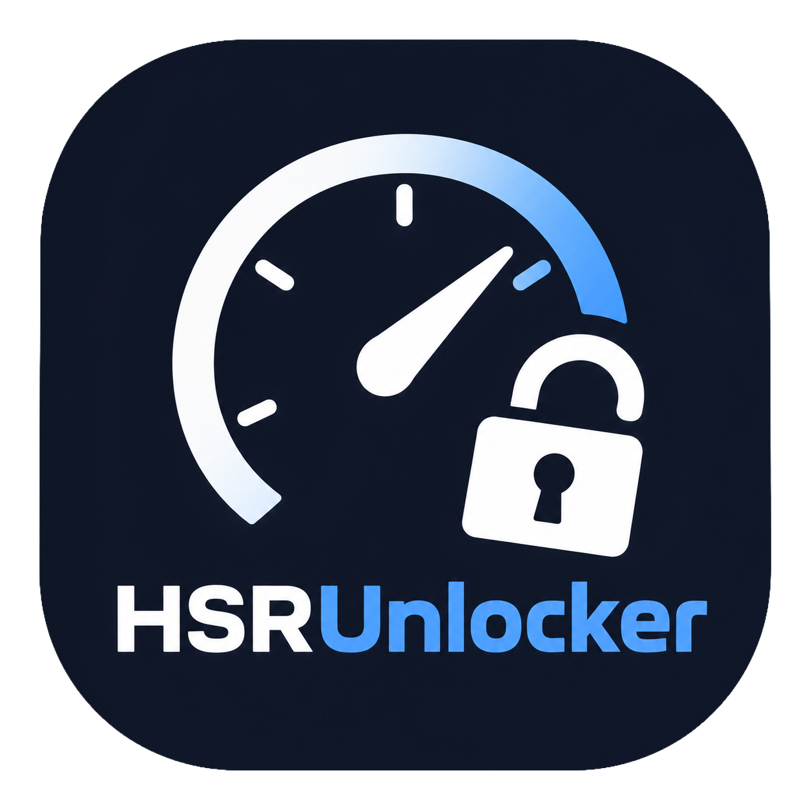

# HSRUnlocker

<p align="center">
  
</p>

崩坏：星穹铁道帧率解锁工具，支持 FOV 调整、移动端 UI 和相机反虚化。使用 C# / .NET 8 与原生 WinUI 3 界面。

A Honkai: Star Rail FPS unlocker with FOV adjustment, mobile UI, and camera anti-fade. Built with C# / .NET 8 and WinUI 3.

[简体中文](#简体中文) | [English](#english)

## 简体中文

### 功能

| 功能 | 说明 |
|---|---|
| 帧率解锁 | 设置 10–480 FPS 上限，默认 120；游戏重设上限时自动恢复目标值。实际帧率取决于硬件与游戏负载。 |
| FOV 调整 | 视野增量范围为 −60° 至 +60°，支持滑块、数值输入和一键归零。 |
| 移动端 UI | 启动游戏时启用触控界面，可沿用客户端已保存的画质设置，并选择安全区边距。 |
| 防止角色淡出（实验性） | 关闭相机靠近或俯仰视角引起的角色淡出（相机反虚化），支持运行时开关。 |
| 启动与附加 | 首次启动自动检测客户端，可随时重新扫描，通过下拉列表切换已记住的路径；从工具启动游戏，或附加到已运行的游戏进程。 |
| 托盘与配置 | 最小化到托盘、单实例、自动保存设置，可选择随工具启动游戏、随游戏退出工具。 |
| 多语言 | 简体中文、English、日本語、한국어；默认跟随系统，可手动切换并保存。 |
| 版本更新 | GitHub / Gitee 并行检查并自动选源，也可固定更新源；发现新版弹窗提示，支持下载安装包、校验、升级并重启。自动检查可关闭。 |
| 安装与卸载 | 安装程序提供安装目录选择、快捷方式、升级及卸载。 |

程序使用动态寻址，游戏更新后仍可能需要适配。

### 运行要求

- Windows 11 22H2（22621）或更高版本，x64。
- 安装程序会检测 .NET 8 x64 和 Windows App Runtime，缺少时联网下载并安装微软官方组件；已有兼容版本时直接复用。
- 管理员权限。

### 使用方法

1. 从 [GitHub Releases](https://github.com/L1angYun/HSRUnlocker/releases) 或 [Gitee Releases](https://gitee.com/liangyun_Liu/HSRUnlocker/releases) 下载 `HSRUnlocker-版本号-win-x64-Setup.exe`，安装后使用快捷方式运行。
2. 首次启动会自动查找已安装的 `StarRail.exe`。找到一个时自动保存；多个时选择客户端；未找到时手动选择。
3. 设置目标帧率、FOV 和所需开关。
4. 点击「启动游戏」，或用「连接游戏」连接已运行的客户端。
5. 点击「停止并还原」恢复帧率上限、FOV 和角色淡出效果，游戏继续运行。

使用移动端 UI 时，请先退出正在运行的游戏，再开启选项并通过工具启动。若提示缺少画质设置，请先以普通模式运行一次对应客户端。「画质设置来源」默认自动识别；国服和国际服选项只决定读取哪份已保存的画质设置。

「移动端安全区」默认「游戏默认」；选择「自定义边距」后可设置左右每侧的安全边距，范围 0–15%，初始值为 5%，用于为刘海或灵动岛预留空间。选择及边距在下次由工具启动移动 UI 时应用，不改变画质设置。

FOV 在下一次镜头更新时生效。最小化后工具会进入托盘，双击托盘图标可恢复窗口。

「游戏退出时关闭工具」默认开启；关闭后可在同一窗口再次启动或连接游戏。正常退出工具时仍会先完成还原。

「版本更新」可手动检查新版，也可关闭启动时的自动检查。发现新版会弹窗，可立即更新、查看发布说明或稍后处理；同次运行对同一版本只提示一次。在托盘中时等恢复窗口后提示。工具会下载并校验安装包，完成还原、退出后安装新版并重启。下载可取消；下载或校验失败不会替换当前程序。

「更新源」默认「自动」，同时查询 GitHub 和 Gitee，在短暂的结果收集窗口内优先选择较新版本，同版本优先使用响应快的源，直接从选定源下载安装包。自动模式下网络故障可尝试另一个源，但不会跳过大小和 SHA-256 校验；同版本的校验信息冲突时停止更新。也可固定为 GitHub 或 Gitee，此时不会跨站切换。Gitee 同步发布可能稍晚，手动固定该源时以其已发布版本为准。

若 1.3.3 通过 Gitee 自动下载安装包失败，请将「更新源」切换为 GitHub，或手动下载并安装新版安装包。1.3.4 修复了 Gitee CDN 将安装包文件名转为小写时的下载兼容问题。

自动查找读取启动器和 Windows 安装记录，也会检查正在运行的客户端，不按文件夹名称判断版本。手动移动游戏后若安装记录失效，可直接选择实际的 `StarRail.exe`。

客户端路径旁的搜索按钮可重新扫描；扫描不会自动更换当前选择。下拉列表保留扫描到和手动选择过的有效路径，选择后立即保存，下次启动仍可切换。文件已失效时从可用列表移除；工具正在启动、附加、运行或还原会话时暂不能切换。

配置和应用日志保存在 `%LOCALAPPDATA%\HSRUnlocker\`，升级与卸载保留这些文件。`settings.json` 使用原子保存，有效的旧配置保留为 `settings.json.bak`；主配置不可用时优先读取备份并记录日志，不会立即重写主配置。升级或卸载前请正常退出工具。

工具退出后若更新失败，会尽量在受保护的 `%ProgramData%\HSRUnlocker-Update-<guid>\` 目录保留有用的 `helper.log` 或 `installer.log`，错误提示会列出实际保留的日志。日志创建或写入失败时可能没有日志；更新成功后会尝试清理本次更新日志。

安装目录保留应用所需的 DLL、XAML、字体与许可文件；.NET 和 Windows App Runtime 使用系统中的共享安装。升级时会清理已识别旧版中的随附运行库，不卸载共享运行时。请保留应用目录完整，通过快捷方式启动。

「界面语言」位于启动设置中，切换后立即更新界面与托盘。已经产生的日志保留原语言，新的提示使用当前语言。

界面使用随包附带的 MiSans 字体，无需额外安装；未包含的韩文等字形使用 Windows 字体回退。

### 从源码构建

安装 .NET 8 SDK，在项目根目录执行：

```powershell
dotnet run --project .\tests\HSRUnlocker.Tests\HSRUnlocker.Tests.csproj -c Release
powershell -NoProfile -File .\build.ps1 -OutDir .\artifacts\win-x64
```

输出位于 `artifacts\win-x64`。输出目录必须为空；再次构建时请指定新的空目录。打包、安装元数据及本地/CI 原生合成测试入口见[参与开发](CONTRIBUTING.md)。

上述普通构建需要已安装对应的 .NET 8 x64 和 Windows App Runtime；添加 `-SelfContained` 可生成包含运行组件的目录。

生成安装程序需要 Inno Setup 7.1 或更高版本：

```powershell
powershell -NoProfile -File .\build-installer.ps1 -OutDir .\artifacts\installer
```

脚本会发布依赖共享运行时的应用，再生成安装程序；可用 `-CompilerPath` 指定 `ISCC.exe`。安装脚本位于 `installer\HSRUnlocker.iss`，固定的微软运行时下载地址与 SHA-256 位于 `installer\runtime-dependencies.json`。安装前完成依赖检查、下载校验和安装；失败时不覆盖现有应用文件，要求重启时需重启后再次安装。

构建同时生成 `update.json`，其中的安装包大小与 SHA-256 来自实际成品。发布时，将安装包、源码 ZIP、`SHA256SUMS.txt` 和 `update.json` 上传到同一版本的正式 Release；GitHub 与 Gitee 使用相同文件。Gitee 的源码同步不代替 Release 附件发布，附件应先上传并核对，最后上传 `update.json`。客户端无需登录或提供令牌。

### 关于 Vibe Coding

本项目采用 **Vibe Coding** 方式开发：AI 参与功能拆解、界面设计、代码、测试和文档编写。这不是一个全部手写的项目，也不会将 AI 生成内容包装成经过独立专业审计的成果。

对这种开发方式的担忧有其理由。AI 可能遗漏边界条件、引入安全问题，生成的测试也可能重复实现中的错误假设。本工具需要管理员权限并修改进程内存，不能用“AI 写的”推卸责任，也不能把“测试通过”当作安全保证。

请根据具体实现和可复现的行为评价这个项目，而不是把开发方式当作质量背书。源码和测试代码公开，欢迎针对正确性、权限使用、稳定性或测试覆盖提出问题和 Pull Request。是否接受这种开发方式、是否运行本工具，由你根据自己的审查与风险判断决定。

### 免责声明

本项目为非官方工具，与游戏开发商及发行商无关联。修改游戏进程可能违反游戏服务条款并带来账号风险，使用者需自行承担相关后果。本软件不提供任何担保。

## English

### Features

| Feature | Description |
|---|---|
| FPS unlock | Set a 10–480 FPS limit, with a default of 120. Automatically reapplies the target when the game resets it. Actual FPS depends on hardware and game load. |
| FOV adjustment | Apply an offset from −60° to +60° using the slider or numeric input, with a reset button. |
| Mobile UI | Enable the touch interface when launching the game, reuse saved graphics settings, and select safe-area margins. |
| Camera anti-fade (experimental) | Disable character fading caused by camera proximity or elevation; can be toggled while playing. |
| Launch and attach | Detect clients on first launch, rescan on demand, switch remembered paths from a dropdown, launch the game, or attach to an existing process. |
| Tray and settings | Minimize to tray, single-instance behavior, saved preferences, optional game launch with the tool, and optional tool exit with the game. |
| Languages | Simplified Chinese, English, Japanese, and Korean. Follows the system by default, with a saved manual choice. |
| Updates | Check GitHub and Gitee in parallel with automatic source selection or a fixed provider, show a new-version prompt, verify the installer, then upgrade and restart. Startup checks can be disabled. |
| Installation | An installer with a selectable directory, shortcuts, upgrades, and uninstallation. |

Addresses are resolved dynamically, but game updates may still require compatibility changes.

### Requirements

- Windows 11 22H2 (build 22621) or later, x64.
- Setup detects .NET 8 x64 and Windows App Runtime, downloading and installing Microsoft's official components when missing. Compatible installed runtimes are reused.
- Administrator privileges.

### Usage

1. Download `HSRUnlocker-version-win-x64-Setup.exe` from [GitHub Releases](https://github.com/L1angYun/HSRUnlocker/releases) or [Gitee Releases](https://gitee.com/liangyun_Liu/HSRUnlocker/releases), install it, and use its shortcut.
2. The first launch searches for installed `StarRail.exe` clients. A single match is saved automatically; choose between multiple matches or browse manually if none are found.
3. Set the target FPS, FOV offset, and desired options.
4. Click Launch game, or Connect to game for a running client.
5. Click Stop and restore to restore the frame rate limit, FOV, and character fading. The game keeps running.

To use mobile UI, close any running game, enable the option, then launch through the tool. If graphics settings are missing, run that client normally once first. The graphics-settings source is detected automatically by default; the China/global choices only select which saved settings to read.

Mobile safe area defaults to Game default. Choose Custom margins to set a margin on each side, from 0 to 15%, initially 5%, leaving room for a notch or Dynamic Island. The selection and margins apply the next time the tool launches mobile UI, without changing graphics settings.

FOV changes apply on the next camera update. Minimizing moves the tool to the tray; double-click its tray icon to restore the window.

Close tool when the game exits is enabled by default. Turn it off to launch or connect again from the same window. Normal tool shutdown still completes restoration before closing.

The Updates section offers a manual check and an optional startup check. A newer release opens a prompt to update, view release notes, or continue later, once per version in the same run. While in the tray, the prompt waits until the window is restored. The tool downloads and verifies the installer, finishes restoration, exits, installs the update, and restarts. Downloads can be cancelled; download or verification failures leave the current application in place.

Update source defaults to Auto. Both providers are queried in parallel; within a short result-collection window, a newer release takes priority, followed by the faster source for equal versions. Downloads start directly from that source. Auto may retry the other provider after a network failure, but never bypasses size or SHA-256 checks; conflicting integrity metadata for the same version stops the update. Choosing GitHub or Gitee fixes that provider without cross-provider retries. Gitee publication may lag behind GitHub, so a fixed Gitee choice uses the versions already published there.

If the automatic Gitee installer download fails in 1.3.3, choose GitHub as the Update source, or manually download and install the new installer. Version 1.3.4 supports Gitee CDN redirects that lowercase the installer filename.

Automatic discovery reads launcher and Windows installation records and checks running clients, without inferring versions from folder names. If moving a game leaves stale installation records, browse to its actual `StarRail.exe`.

The search button beside the client path rescans without replacing the current selection. The dropdown remembers valid discovered and manually chosen paths; selecting one saves it immediately for subsequent launches. Missing files are removed from the available list. Switching is disabled while the tool starts, attaches, runs, or restores a session.

Settings and application logs are stored in `%LOCALAPPDATA%\HSRUnlocker\` and retained during upgrades and uninstallation. Writes to `settings.json` are atomic, keeping the previous valid settings as `settings.json.bak`. If the primary settings are unusable, the tool reads the backup first and logs the recovery without immediately rewriting the primary file. Close the tool normally before upgrading or uninstalling.

If an update fails after the tool exits, it tries to retain useful `helper.log` or `installer.log` files in the protected `%ProgramData%\HSRUnlocker-Update-<guid>\` directory. The error message lists logs that remain; logs may be unavailable if creation or writing fails. Successful updates attempt to remove their logs.

The installation directory retains application DLLs, compiled XAML, fonts, and licenses. .NET and Windows App Runtime use shared system installations. Upgrades clean up previously bundled runtime files in recognized older installations without uninstalling shared runtimes. Keep the application directory intact and launch the tool using its shortcut.

The language selector is in the startup settings. Changes immediately update the interface and tray. Existing log entries retain their original language; new messages use the current selection.

MiSans is bundled with the application. Characters it does not include, such as Hangul, use Windows font fallback.

### Build From Source

Install the .NET 8 SDK, then run from the repository root:

```powershell
dotnet run --project .\tests\HSRUnlocker.Tests\HSRUnlocker.Tests.csproj -c Release
powershell -NoProfile -File .\build.ps1 -OutDir .\artifacts\win-x64
```

The output is in `artifacts\win-x64`. The output directory must be empty; choose a new empty directory for subsequent builds. See [CONTRIBUTING.md](CONTRIBUTING.md) for packaging, installer metadata, and the shared local/CI native synthetic test entrypoint.

This ordinary build needs the matching .NET 8 x64 and Windows App Runtime installed. Add `-SelfContained` to bundle runtime components.

To build the installer, install Inno Setup 7.1 or later and run:

```powershell
powershell -NoProfile -File .\build-installer.ps1 -OutDir .\artifacts\installer
```

The script publishes a framework-dependent application and compiles the installer. Use `-CompilerPath` to select `ISCC.exe`. The installer definition is in `installer\HSRUnlocker.iss`; pinned Microsoft runtime URLs and SHA-256 hashes are in `installer\runtime-dependencies.json`. Prerequisites are checked, verified, and installed before application files are replaced. Failures leave existing application files intact; a requested restart requires rebooting and running Setup again.

The build also generates `update.json` using the actual installer's size and SHA-256. Upload the installer, source ZIP, `SHA256SUMS.txt`, and `update.json` to the same stable release, using identical files on GitHub and Gitee. Source synchronization does not publish Gitee release attachments. Upload and verify the other attachments before publishing `update.json` last. Clients do not need to sign in or supply a token.

### About Vibe Coding

This project uses **Vibe Coding**: AI contributes to feature planning, UI design, code, tests, and documentation. It is not an entirely handwritten project, and AI-generated work is not presented as an independent professional audit.

Concerns about this approach are reasonable. AI can miss edge cases, introduce security problems, and generate tests that repeat the implementation's incorrect assumptions. This tool runs with administrator privileges and modifies process memory. "AI wrote it" does not excuse defects, and passing tests does not establish safety.

Judge the project by its implementation and reproducible behavior, not by treating its development method as a quality endorsement. The source and test code are public. Reports and pull requests addressing correctness, privileges, stability, or test coverage are welcome. Whether to accept this development approach or run the tool is your decision, based on your own review and assessment of the risks.

### Disclaimer

This is an unofficial tool, unaffiliated with the game's developer or publisher. Modifying the game process may violate its terms of service and put accounts at risk. Use it at your own risk. The software is provided without warranty.

## License

[GPL-3.0-only](LICENSE). Third-party dependencies retain their respective licenses; see [THIRD_PARTY_NOTICES.md](THIRD_PARTY_NOTICES.md).
