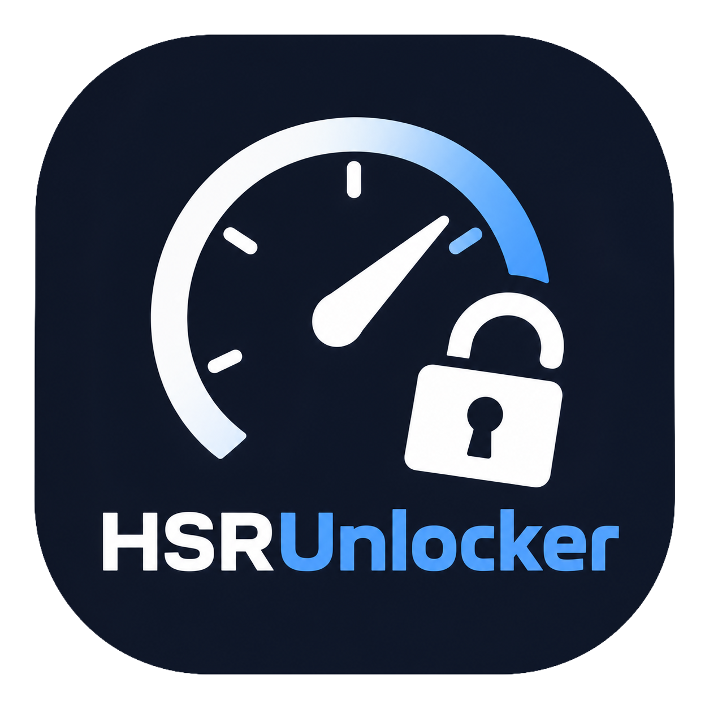

# HSRUnlocker

  

[简体中文](#简体中文) | [English](#english)

## 简体中文

崩坏：星穹铁道帧率解锁工具，支持 10–480 FPS 上限、FOV 调整、移动端 UI 与安全区设置，以及实验性的防止角色淡出功能。

**下载：** [GitHub Releases](https://github.com/L1angYun/HSRUnlocker/releases) · [Gitee Releases](https://gitee.com/liangyun_Liu/HSRUnlocker/releases)

需要 Windows 11 22H2 或更高版本（x64）和管理员权限。安装程序会检查所需的 .NET 8 和 Windows App Runtime，缺少时下载微软官方组件。

### 快速开始

1. 下载并运行 `HSRUnlocker-版本号-win-x64-Setup.exe`，安装后使用快捷方式打开工具。
2. 首次启动会搜索 `StarRail.exe`。只找到一个时自动保存；找到多个时请选择客户端；未找到时手动浏览。
3. 设置目标帧率和所需选项，点击「启动游戏」，或点击「连接游戏」连接已运行的客户端。
4. 点击「停止并还原」结束本次会话并尝试还原修改，游戏继续运行。最小化后可双击托盘图标恢复窗口。

客户端路径会保存并在下次启动时显示，前提是文件仍然有效。路径旁的搜索按钮可重新扫描，当前选择会保留；可在下拉列表切换客户端，悬停查看完整路径。

使用移动端 UI 前，请退出游戏、开启对应选项，再通过工具启动游戏。如提示缺少画质设置，请先正常运行该客户端一次。「版本更新」中可以手动检查新版，也可以关闭启动时的自动检查。

### 反馈与开发

会话失败时，可从应用内提示打开 [GitHub Issues](https://github.com/L1angYun/HSRUnlocker/issues)。请附工具版本、复现步骤和必要的脱敏错误行；无需上传完整日志、个人路径、账号信息或内存转储。安全问题请参阅[安全说明](SECURITY.md)。

构建、测试和发布步骤见[参与开发](CONTRIBUTING.md)。本项目在开发中使用 AI 辅助，未经独立安全审计。

这是非官方工具。修改游戏进程可能违反游戏服务条款并带来账号风险。

## English

An FPS unlocker for Honkai: Star Rail, with a 10–480 FPS cap, FOV adjustment, mobile UI and safe-area settings, and an experimental option to prevent character fading.

**Download:** [GitHub Releases](https://github.com/L1angYun/HSRUnlocker/releases) · [Gitee Releases](https://gitee.com/liangyun_Liu/HSRUnlocker/releases)

Requires Windows 11 22H2 or later (x64) and administrator privileges. Setup checks for .NET 8 and Windows App Runtime and downloads the official Microsoft components when needed.

### Quick start

1. Download and run `HSRUnlocker-version-win-x64-Setup.exe`, then open the tool from its shortcut.
2. On first launch, the tool looks for `StarRail.exe`. It saves a single match automatically. If it finds several clients, choose one; if it finds none, browse to the executable.
3. Set your target FPS and other options. Choose **Launch game** or **Connect to game** if the client is already running.
4. Choose **Stop and restore** to end the session and attempt to restore the changes while the game keeps running. Double-click the tray icon to restore a minimized window.

The tool saves the selected client path and displays it at startup if the file is still valid. The search button rescans and keeps your selection. Use the dropdown to switch clients and hover to see the full path.

To use mobile UI, close the game, enable the option, then launch it through the tool. If graphics settings are missing, run that client normally once. In **Updates**, you can check manually or turn off checks at startup.

### Feedback and development

If a session fails, the notice in the app links to [GitHub Issues](https://github.com/L1angYun/HSRUnlocker/issues). Include the app version, steps to reproduce, and any relevant sanitized error lines. Leave out full logs, personal paths, account details, and memory dumps. For security issues, see the [security policy](SECURITY.md).

See [Contributing](CONTRIBUTING.md#english) for build, test, and release instructions. The project is developed with AI assistance and has not undergone an independent security audit.

This is an unofficial tool. Modifying the game process may violate the game's terms of service and put your account at risk.

## License

[GPL-3.0-only](LICENSE) · [Third-party notices](THIRD_PARTY_NOTICES.md)
